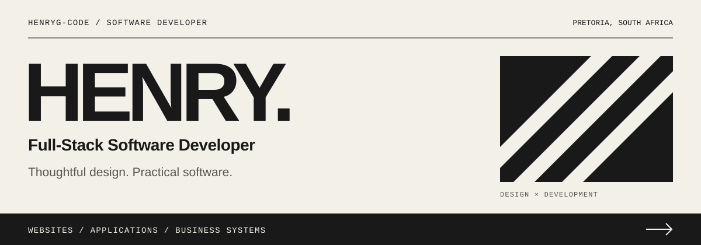

  <picture>
    <source media="(max-width: 600px)" srcset="./assets/editorial-motion-mobile.svg" />
    
  </picture>

  <a href="https://henrygo.co.za/">Portfolio</a> &nbsp; / &nbsp;
  <a href="https://www.linkedin.com/in/henry-gagiano/">LinkedIn</a> &nbsp; / &nbsp;
  <a href="https://github.com/HenryG-code?tab=repositories">Repositories</a>

## Software with a practical purpose

I'm **Henry**, a software developer based in **Pretoria, South Africa**. I build web applications, business websites, dashboards, and tools that turn everyday workflows into useful software.

My work spans interfaces, back-end logic, databases, and deployment. I care about clear user journeys, fast pages, and code that stays maintainable as a product grows.

## Websites & business systems

Alongside my public repositories, my [portfolio](https://henrygo.co.za/#section-portfolio) showcases business websites, commerce experiences, dashboards, and integrations.

| Selected work | Focus |
| :--- | :--- |
| [SINO Plant](https://sinoplant.co.za/) | Catalog-driven website with product discovery, branch visibility, and lead capture. |
| [TentPro](https://tentpro.co.za/) | Shopify storefront focused on product discovery and mobile shopping. |
| [Guide2Cars](https://guide2cars.co.za/) | Automotive consultancy website covering buying, selling, and vehicle evaluation services. |

My [business application work](https://henrygo.co.za/#work-apps) includes a leads dashboard and an ERP-to-Shopify integration. The portfolio also covers a CRM and a branch visitor-counting system **in development**.

[Explore the full portfolio →](https://henrygo.co.za/#section-portfolio)

## Selected GitHub projects

### 01 / [LogFit](https://github.com/HenryG-code/MyFitnessApp)

A full-stack fitness portfolio project that brings workout logging, progress, habits, and meal planning into one system. Includes authenticated accounts, user-specific data, and an Expo mobile companion.

**Next.js · TypeScript · Supabase · PostgreSQL · Tailwind CSS**  
[Explore the code →](https://github.com/HenryG-code/MyFitnessApp) · [Live project →](https://fitness.weblytics.co.za)

### 02 / [Universe Atlas](https://github.com/HenryG-code/Solar-system)

A space exploration interface with animated planetary orbits, NASA imagery, and an Astronomy Picture of the Day spotlight. Built with native web technologies and no framework.

**JavaScript · HTML · CSS · NASA APIs**  
[Explore the code →](https://github.com/HenryG-code/Solar-system)

### 03 / [Voxium Invaders](https://github.com/HenryG-code/Voxium-Invaders-Game)

A playable mobile arcade prototype with real-time combat, enemy spawning, boss encounters, audio, and touch controls. An exploration of game loops and interactive mobile experiences.

**React Native · Expo · TypeScript**  
[Explore the code →](https://github.com/HenryG-code/Voxium-Invaders-Game)

## Tools I work with

| Area | Technologies |
| :--- | :--- |
| Web interfaces | TypeScript, JavaScript, React, Next.js, Astro, Tailwind CSS |
| Back end & data | Node.js, ASP.NET Core, Supabase, PostgreSQL, MySQL |
| Mobile | React Native, Expo |
| Content & commerce | WordPress, WooCommerce, Shopify, Liquid |
| Delivery | Git, GitHub, Docker, Vercel, cPanel |

## What I'm focused on

- Building full-stack applications with useful dashboards and clear data flows.
- Creating fast business websites with **Astro, TypeScript, and Tailwind CSS**.
- Exploring mobile experiences with **React Native and Expo**.
- Experimenting with local AI and automation, alongside performance, SEO, and analytics work.

---

**Have a project in mind?** Find my work on my [portfolio](https://henrygo.co.za/) or connect on [LinkedIn](https://www.linkedin.com/in/henry-gagiano/).
